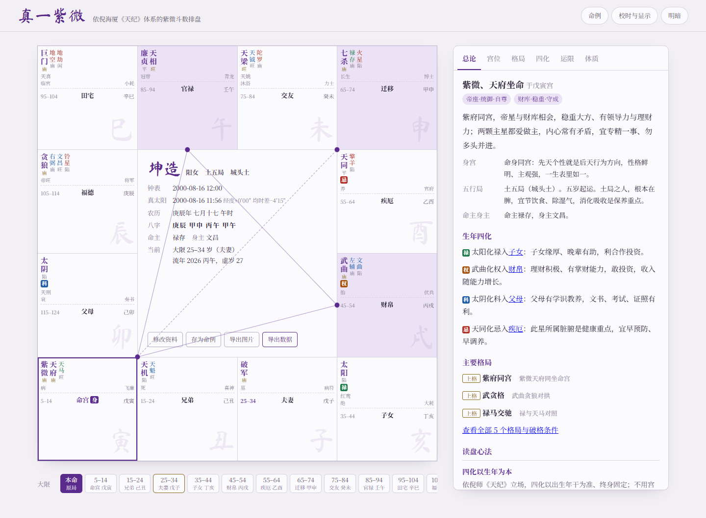

# 真一紫微 ZHENYI Ziwei

### 从出生时间，到一张完整命盘

[English](README.en.md) · [真一官网](https://www.zhenyi.org/) · [接口文档](docs/API.md) · [参与开发](CONTRIBUTING.md)

**真一紫微是一套开源的紫微斗数排盘引擎。** 输入出生日期、时间与地点，程序计算历法与真太阳时，安十二宫、星曜和四化，接着推演格局与运限。读盘思路参考倪海厦《天纪》，排盘过程、规则、网页和 API 都随源码开放。

想直接使用真一，可以前往 [www.zhenyi.org](https://www.zhenyi.org/)；想自己部署或二次开发，从这个仓库开始。



| 1900.01—2100 | 0 个运行依赖 | 单文件网页 + HTTP API |
| :---: | :---: | :---: |
| 从 1900-01-31 起，覆盖公历两百余年 | Node.js 18+ 即可运行 | 浏览器使用，也能接入自己的系统 |

## 一张盘是怎么排出来的

**先算时间。** 从公历、农历、节气到干支，计算从仓库里的天文与历法模块开始。出生地经度、均时差和中国历史夏令时会进入真太阳时校正；晚子时与闰月口径也可设置。

**再安命盘。** 命身宫、十二宫、十四主星、辅煞杂曜、庙旺与生年四化由排盘引擎生成。大限、小限和流年、流月、流日接着落到盘上。

**最后看格局。** 格局规则会检查成立条件、加分条件与破格条件。网页提供总论、宫位、四化、格局、运限等视图，也能保存命例和导出数据。

| 核心模块 | 源码 |
| --- | --- |
| 天文历法与农历 | `src/astro.js`、`src/calendar.js` |
| 校时与紫微排盘 | `src/ziwei.js` |
| 格局与规则解读 | `src/analysis.js`、`src/content.js` |
| 网页界面 | `src/app.js`、`src/styles.css` |
| HTTP 接口 | `server.js` |

四化以生年干为本，安星采用《紫微斗数全书》的通行方法，读盘口径参考倪海厦《天纪》。项目与倪海厦本人及相关机构没有隶属关系。

## 直接运行

```bash
git clone https://github.com/ZHENYI-ORG/zhenyi-ziwei.git
cd zhenyi-ziwei
npm run build
```

打开 `dist/index.html`，就能在浏览器里排盘。无需安装 npm 依赖。

需要程序调用时，运行 `npm start`，接口默认监听 `127.0.0.1:3001`：

```bash
curl http://127.0.0.1:3001/generate \
  -H "Content-Type: application/json" \
  -d '{"year":2000,"month":8,"day":16,"clockHour":12,"clockMinute":0,"longitude":120,"gender":"female"}'
```

返回命盘、运限、格局与完整的 `native` 结果。接口字段和接入方式见 [API 文档](docs/API.md)。

## 从网页到自己的产品

这个仓库交付排盘引擎、网页、格局规则、HTTP API 和测试。你可以直接使用单文件网页，也可以让自己的服务调用 `/generate`，把排盘结果接入其他应用。源码采用 [MIT License](LICENSE)，允许修改和二次开发。

网页内置规则生成的解读。**AI 深度解盘需要宿主页面提供 `window.claude` 能力**；普通静态部署不会自动连接 AI 服务。仓库没有附带模型权重。开发者可以按自己的服务架构接入。

项目包含 11 组引擎检查与 API 检查，并在 CI 中运行构建；命盘测试还覆盖 2,000 张随机生成盘。欢迎带着具体出生资料、排盘结果与流派口径提交 [Issue](https://github.com/ZHENYI-ORG/zhenyi-ziwei/issues) 或 [PR](CONTRIBUTING.md)。

## Star History

如果这套排盘引擎对你有用，欢迎点个 Star，让更多做紫微斗数产品的人找到它。

[](https://star-history.com/#ZHENYI-ORG/zhenyi-ziwei&Date)
